# IGH 智能制造平台 — 系统功能说明

> 文档版本：v1.0
> 编制日期：2026-11-15
> 适用系统：IGH 智能制造平台（华祥智纤九江项目）
> 文档用途：说明系统各功能区域的能力与界面构成

---

## 目录

1. [系统概述](#1-系统概述)
2. [各区域登录入口](#2-各区域登录入口)
3. [区域功能说明](#3-区域功能说明)
4. [数据层级关系](#4-数据层级关系)
5. [相关文档](#5-相关文档)

---

## 1. 系统概述

### 1.1 平台定位

IGH 智能制造平台面向化纤长丝生产车间，覆盖从卷绕落筒、外检判级、称重分等、中间仓储到自动打包的完整生产链路，实现：

- **生产数据自动采集**：卷绕机落筒、外检判级、称重结果自动入库，无需人工录入
- **全流程质量追溯**：任意一只丝饼可从成品栈板逐级回溯到落筒机位与生产时刻
- **实时生产监控**：车间看板实时展示产量、等级分布与设备告警
- **与 ERP 系统对接**：落筒、丝车等生产数据可推送至客户方 ERP

### 1.2 系统组成

系统采用「中心 + 边缘」两层架构：

| 组成部分 | 部署位置 | 主要职责 |
|---|---|---|
| 中心管理系统 | 机房服务器 | 数据汇总存储、生产管理、质量追溯、统计报表、ERP 对接 |
| 边缘端系统 | 车间工控机 | 直连 PLC 采集设备数据、驱动现场打印、断网时本地缓存 |
| 管理后台 | 浏览器访问 | 管理员、调度、质量、仓库人员的操作界面 |
| 车间看板 | 车间大屏 | 产量、告警、仓库状态实时展示 |
| 现场工位 | 工位终端 | 卷绕、外检、包装、仓库四个岗位的操作界面 |

**断网续传**：边缘端在车间网络中断时继续本地采集，网络恢复后自动补传，生产数据不丢失。

### 1.3 界面分区

| 分区 | 面向对象 | 页面数 |
|---|---|---|
| 登录 | 全部用户 | 1 |
| 管理后台 | 管理员、调度、质量、仓库 | 15 |
| 车间看板 | 车间大屏 | 3 |
| 现场工位 | 现场操作工 | 4 |

**功能模块可配置**：落筒、质量、仓库、包装、ERP、维保、载具七个功能模块支持按项目需要启用或关闭。未启用的模块其页面入口与数据均不显示，不影响其他模块正常使用。

---

## 2. 各区域登录入口

系统各区域**共用同一个登录页**，登录后按账号角色自动进入对应区域的界面。

### 2.1 登录账号

| 区域 | 账号 | 初始密码 |
|---|---|---|
| 管理后台 | `admin` | `admin123` |
| 卷绕工位 | `winding01` | `123456` |
| 外检工位 | `sorting01` | `123456` |
| 包装工位 | `packaging01` | `123456` |
| 仓库工位 | `warehouse01` | `123456` |

> 上述为系统初始化账号，正式上线时由管理员按现场人员在「系统设置 → 用户管理」中重新分配，并强制修改初始密码。

### 2.2 现场免登录

工位终端支持**按 IP 自动识别**：在现场配置中预先登记工位终端的 IP 与工位类型，终端打开系统后无需输入账号密码，直接进入本工位操作界面。识别不到时进入车间总览看板。

### 2.3 登录界面

| 区域 | 登录页 | 登录后界面 |
|---|---|---|
| 管理后台 |  |  |
| 卷绕工位 | 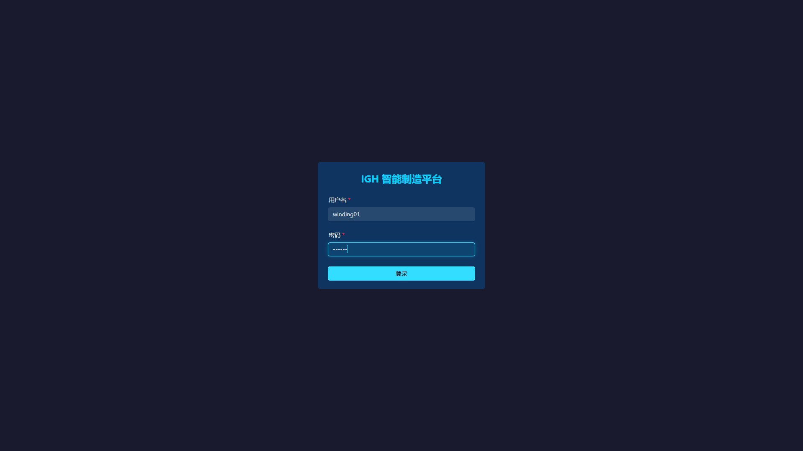 | 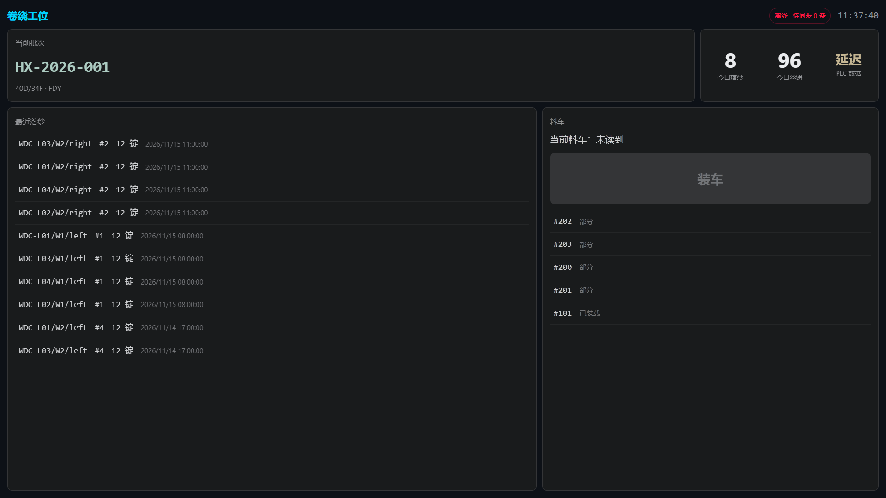 |
| 外检工位 | 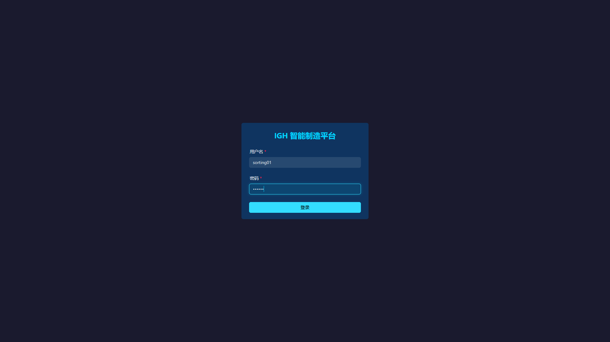 | 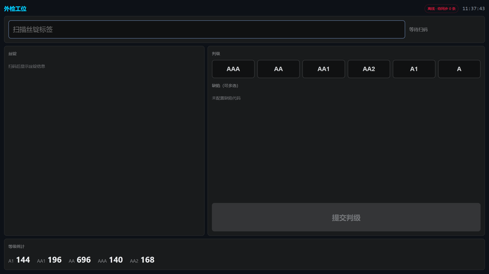 |
| 包装工位 | 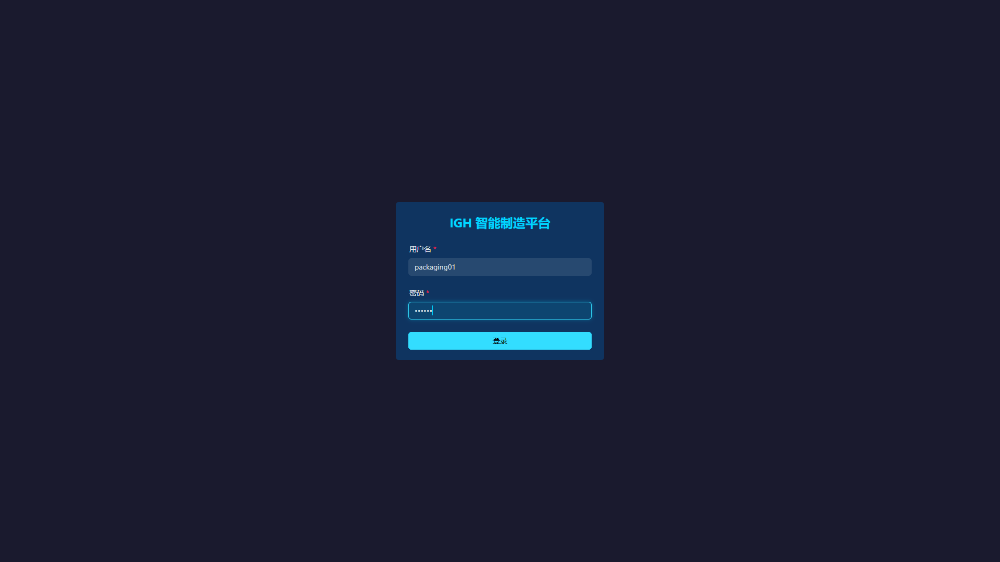 |  |
| 仓库工位 |  | 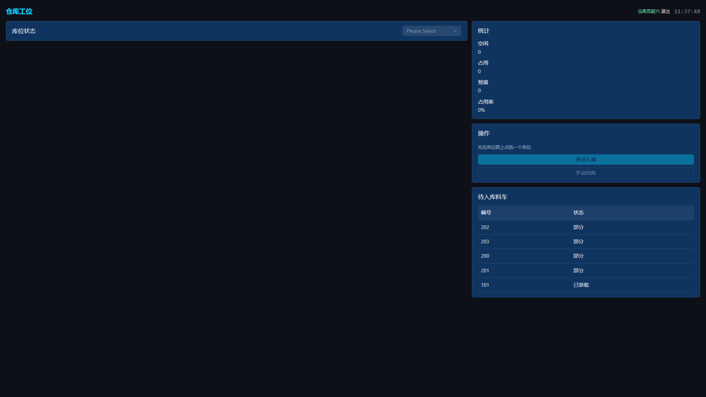 |

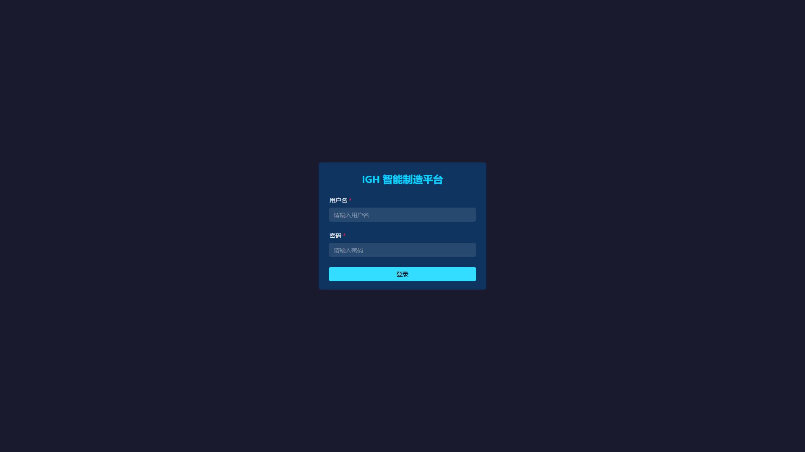

---

## 3. 区域功能说明

### 3.1 管理后台

#### 3.1.1 管理总览

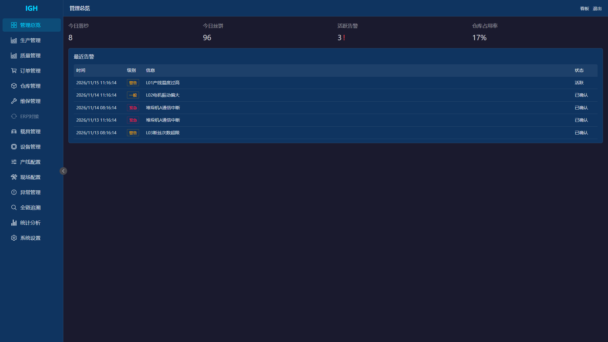

车间生产的一个总览视图，打开后可快速掌握当班生产情况。

| 区域 | 内容 |
|---|---|
| 顶部四指标 | 今日落纱次数、今日丝饼数量、活跃告警数量、仓库占用率 |
| 最近告警 | 最近 5 条告警的时间、级别、内容、处理状态 |

**指标口径说明**
- 「今日」按当日 00:00 至当前时刻统计，不含前一日数据
- 仓库占用率为首个仓库的库位占用比例，多个仓库可分别查看

#### 3.1.2 生产管理

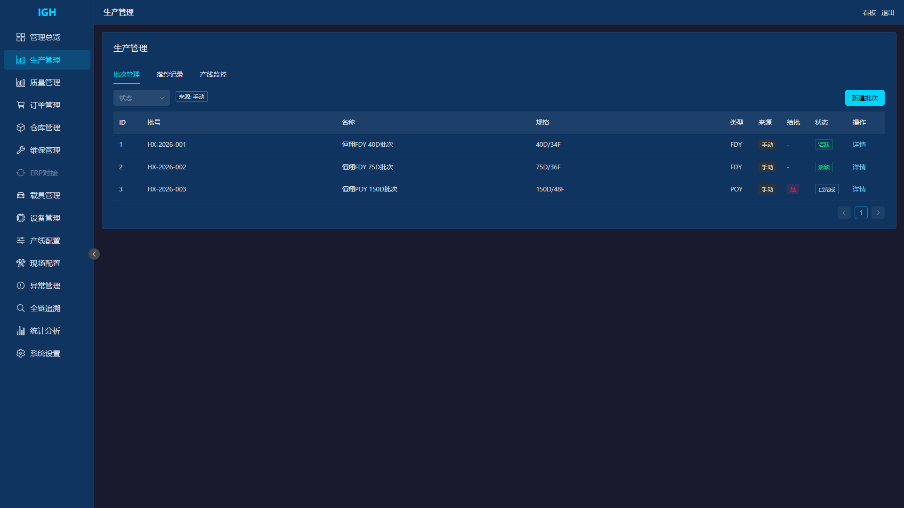

按「批次 → 落筒」两个维度管理生产。

**批次管理**

| 功能 | 说明 |
|---|---|
| 批次列表 | 显示批号、名称、规格、类型、来源、结批情况、状态 |
| 筛选 | 按状态、按来源筛选 |
| 新建批次 | 手工录入批号、规格、产品类型、工单号等 |
| 结批 | 一批生产完成后结批，结批后不再产生新的落筒数据 |

**批次详情**分四个子标签：

| 标签 | 内容 |
|---|---|
| 基本信息 | 批号、名称、规格、产品类型、工单号、执行标准、光泽、捻向、纸管颜色 |
| 工艺参数 | 出口规格、国际标准等工艺补充信息 |
| 码垛配置 | 默认垛层数、默认每层锭数 |
| 重量规格 | 按层级维护毛重与净重 |
| 等级范围 | 按等级维护重量区间 |

**落纱记录**：按落筒维度查询生产记录，含产线、机位、落筒号、批号、锭数、落筒时间。

**产线监控**：查看各卷绕机机位的实时运行状态，可手动刷新。

#### 3.1.3 质量管理

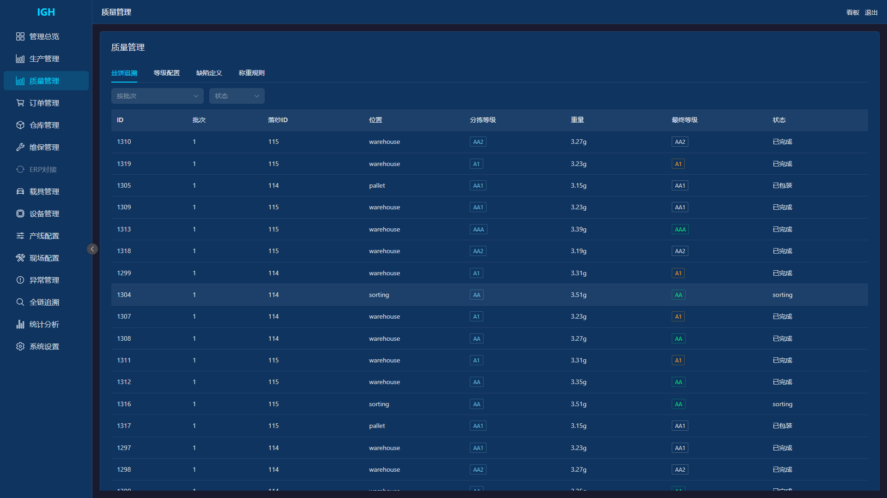

| 标签 | 功能 |
|---|---|
| 丝饼追溯 | 丝饼明细列表：落纱编号、当前位置、外检等级、重量、最终等级、状态 |
| 等级配置 | 等级代码与名称维护（AAA / AA / AA1 / AA2 / A1 / A） |
| 缺陷定义 | 缺陷代码维护，供外检判级时选用 |
| 称重规则 | 按批号维护重量区间与对应等级，称重后自动判定 |

#### 3.1.4 订单管理

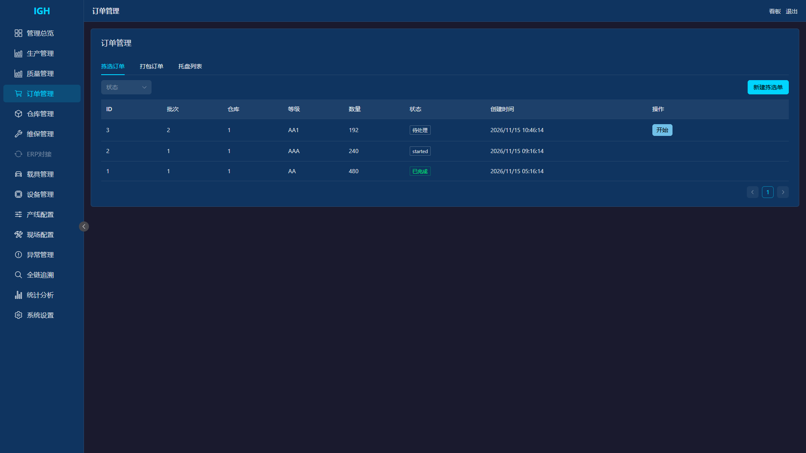

| 标签 | 功能 |
|---|---|
| 拣选订单 | 按批号与等级从仓库拣货；支持新建、开始、完成，状态流转为「待处理 → 进行中 → 已完成」 |
| 打包订单 | 指定打包机与目标数量，实时跟踪已打包数量 |
| 托盘列表 | 已生成的栈板记录 |

#### 3.1.5 仓库管理

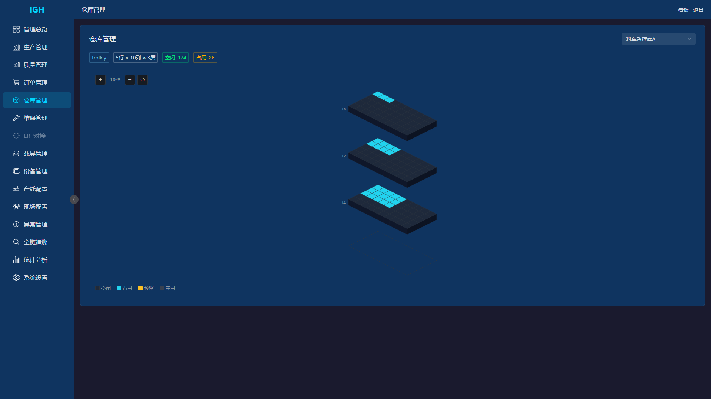

- **三维货位图**：按层渲染货位，颜色区分「空闲 / 占用 / 预留 / 禁用」，鼠标悬停可查看库位详情
- **多仓库切换**：料车暂存库 A、料车暂存库 B、成品暂存库、空车存放区
- **统计条**：仓库类型、行列层尺寸、空闲库位数、占用库位数
- **缩放控制**：放大、缩小、复位

#### 3.1.6 维保管理

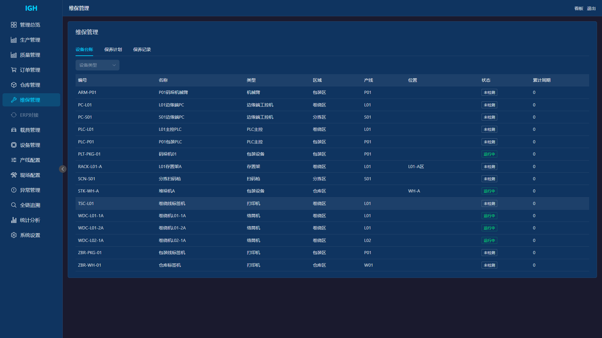

| 标签 | 功能 |
|---|---|
| 设备台账 | 设备编号、名称、类型、区域、产线、位置、运行状态、累计运行周期 |
| 保养计划 | 按设备配置周期性保养计划，支持提前预警天数设置 |
| 保养记录 | 每次保养的内容、执行人、耗时、执行时间登记与查询 |

系统可提示**即将到期**与**已逾期**的保养任务。

#### 3.1.7 异常管理

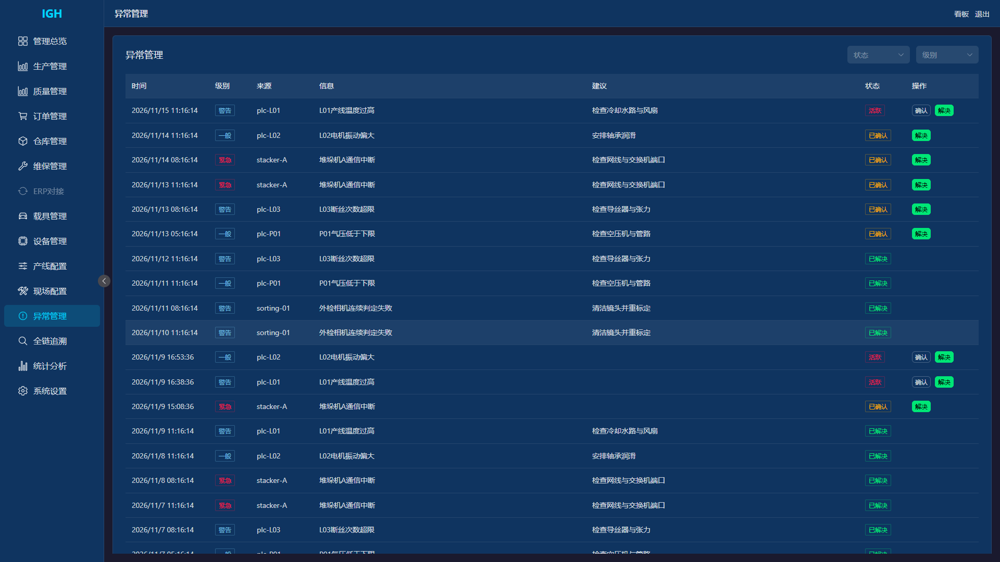

| 功能 | 说明 |
|---|---|
| 告警列表 | 时间、级别（一般 / 警告 / 紧急）、来源设备、告警内容、处置建议、处理状态 |
| 确认 | 班组长确认已知悉该告警 |
| 解决 | 处置完成后标记为解决，记录解决时间 |
| 筛选 | 按处理状态、按告警级别筛选 |

#### 3.1.8 全链追溯

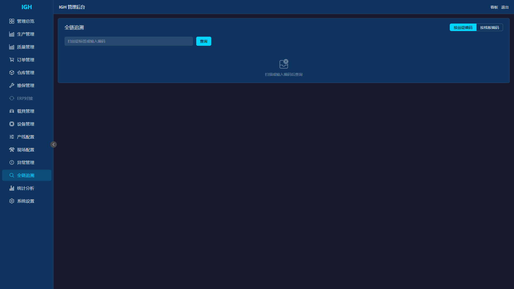

客诉查货与质量问题定位的主要工具。

- **双模查询**：支持按「丝饼编码」或「栈板编码」查询，扫码枪可直接扫描标签录入
- **链路展示**：完整呈现 丝饼 → 落筒 → 批次 → 仓库 → 栈板 的全链路信息
- **缺环提示**：若链路中有环节缺失，页面会明确标出缺失项，不会静默跳过
- **查无提示**：编码不存在时提示「查无此编码」，与系统故障区分开

#### 3.1.9 统计分析

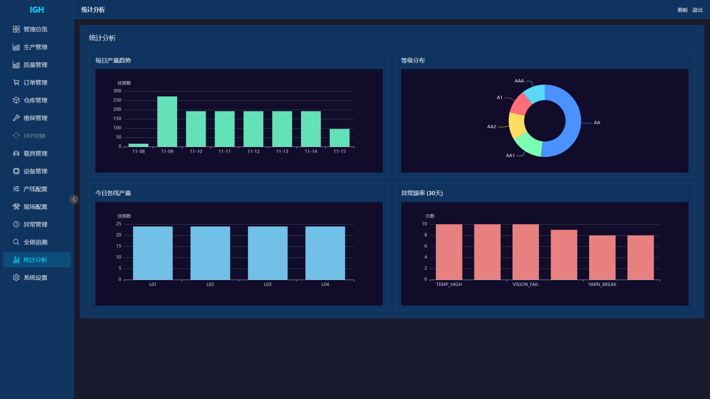

| 图表 | 内容 |
|---|---|
| 每日产量趋势 | 近 7 日每日落筒次数与丝饼数量柱状图 |
| 等级分布 | 各等级丝饼数量占比环形图 |
| 今日各线产量 | 当日各条产线的丝饼产量对比 |
| 异常频率 | 近 30 日各告警类型的发生次数统计 |

#### 3.1.10 设备管理

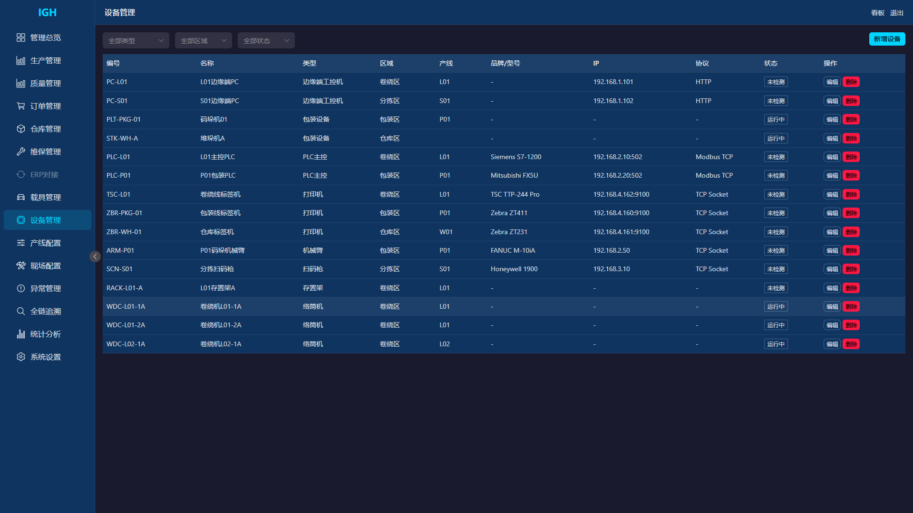

- **设备列表**：编号、名称、类型、区域、产线、品牌型号、IP 地址、通信协议、状态
- **筛选**：按设备类型、区域、状态筛选
- **维护**：新增、编辑、删除设备
- **支持的设备类型**：边缘端工控机、PLC 主控、包装设备、打印机、机械臂、扫码枪、存置架、络筒机
- **支持的通信协议**：HTTP、Modbus TCP、TCP Socket、MQTT

> 设备管理与维保管理中的「设备台账」为同一份设备数据，任一处维护后另一处同步更新。

#### 3.1.11 产线配置

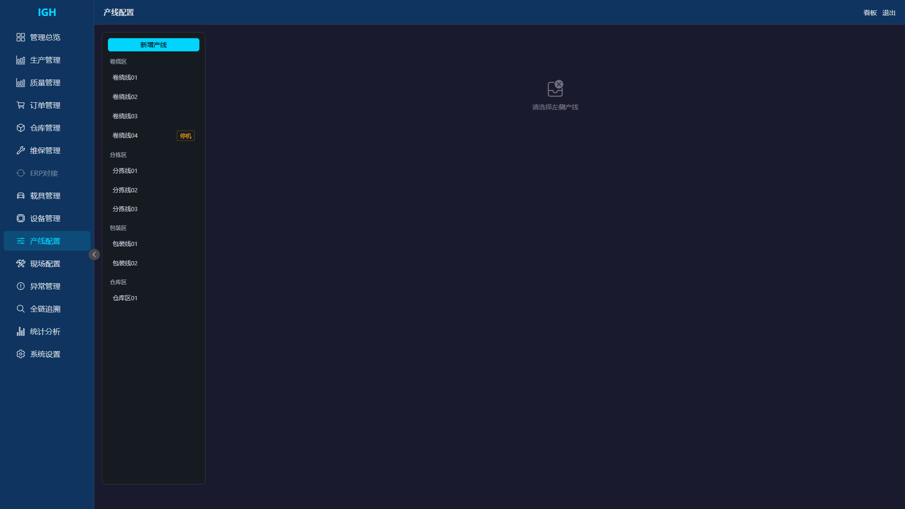

- **产线分组**：按区域列出全部产线（卷绕区、分拣区、包装区、仓库区）
- **运行状态**：停机的产线带「停机」标记
- **产线配置**：选中产线后可查看与修改该产线的配置项；卷绕线额外包含 PLC 绑定配置

#### 3.1.12 现场配置

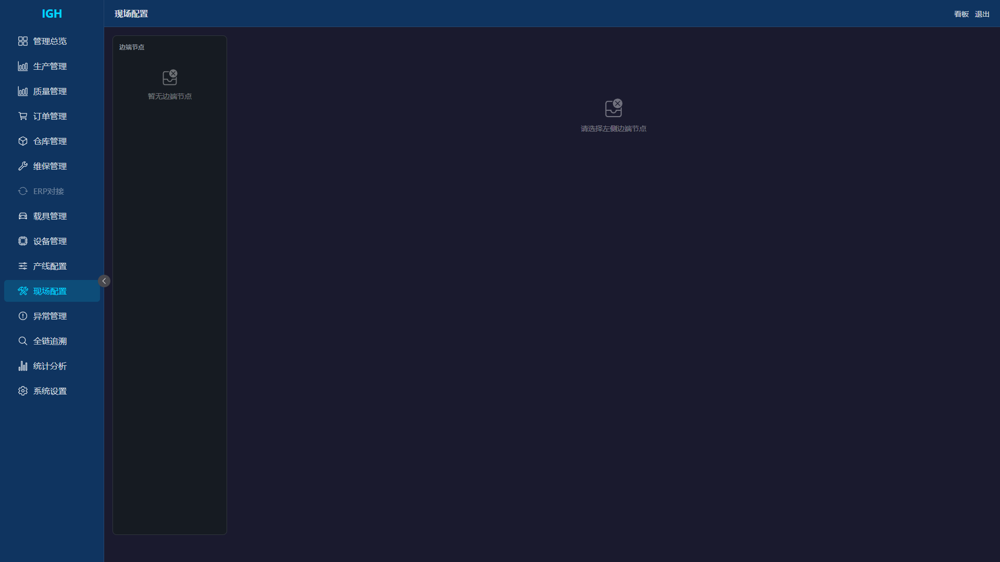

用于集中管理各个边缘端节点的运行配置。

| 功能 | 说明 |
|---|---|
| 节点列表 | 已注册的边缘端节点 |
| 读取配置 | 查看某节点当前生效的配置 |
| 下发配置 | 修改后下发至该节点，节点实时生效 |
| 下发前校验 | 配置格式与取值合法性检查，校验不通过不下发 |
| 套用模板 | 从预置配置模板快速生成节点配置 |
| 指定版本 | 为节点指定目标程序版本 |

#### 3.1.13 载具管理

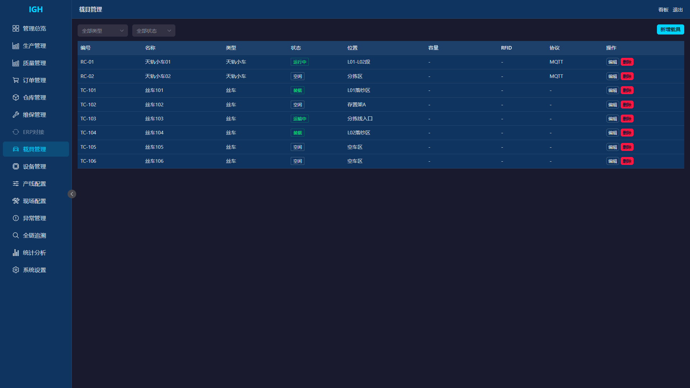

- **载具类型**：天轨小车、丝车
- **载具信息**：编号、名称、类型、状态（运行中 / 空闲 / 装载 / 运输中）、当前位置、背量、RFID、通信协议
- **维护**：新增、编辑、删除

#### 3.1.14 系统设置

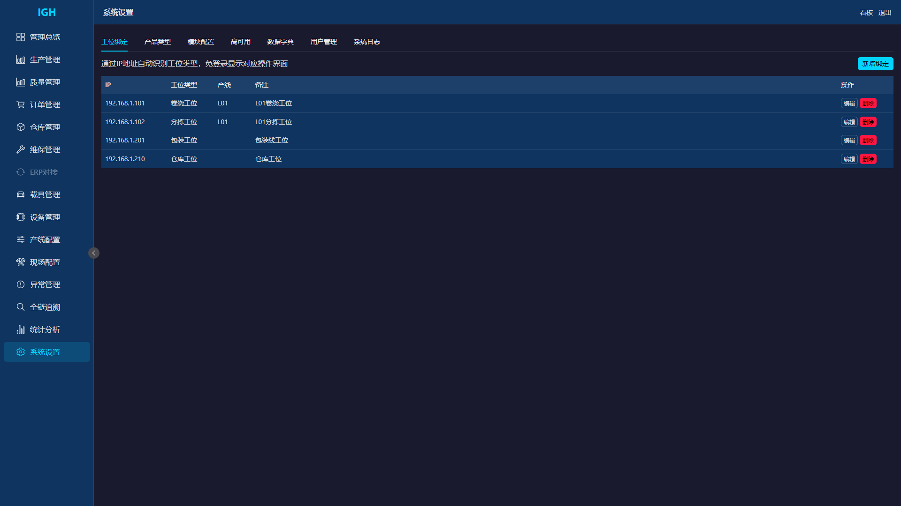

| 标签 | 功能 |
|---|---|
| 工位绑定 | 登记工位终端 IP 与工位类型，实现现场免登录 |
| 产品类型 | POY / FDY / DTY 等产品类型维护 |
| 模块配置 | 启用或关闭各功能模块 |
| 高可用 | 双机热备模式、主机角色、虚拟 IP 状态查看与切换 |
| 数据字典 | 各类下拉选项的通用字典维护 |
| 用户管理 | 用户增删改、角色分配、重置密码 |
| 系统日志 | 系统操作日志与异常日志查询 |

#### 3.1.15 ERP 对接

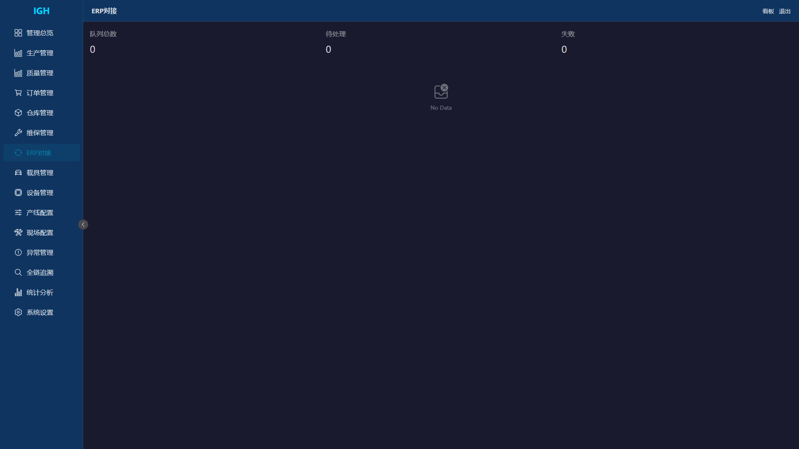

- **状态指标**：待推送队列总数、待处理数量、失败数量
- **队列明细**：逐条查看推送记录与失败原因
- **重试**：失败记录可手工重试
- **手工触发**：支持手动触发一次推送处理

> 本模块按项目需要启用。未启用时页面各指标为 0，属正常状态。

---

### 3.2 车间看板

车间大屏使用的只读界面，深色高对比配色，适配远距离观看。

#### 3.2.1 总览看板

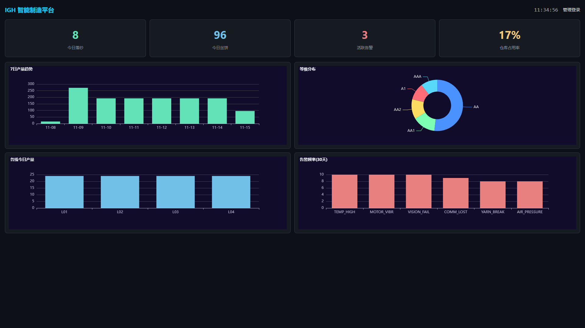

- **四大指标卡**：今日落纱、今日丝饼、活跃告警、仓库占用率
- **四张图表**：7 日产量趋势、等级分布、各线今日产量、告警频率（30 天）

#### 3.2.2 仓库看板

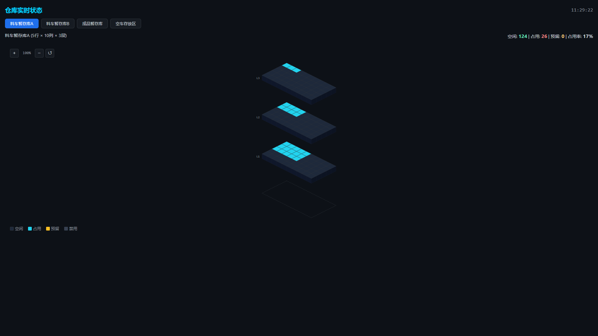

- **仓库切换**：料车暂存库 A / B、成品暂存库、空车存放区
- **三维货位图**：按层展示库位占用情况，配颜色图例
- **实时统计**：空闲、占用、预留库位数与占用率

#### 3.2.3 生产看板

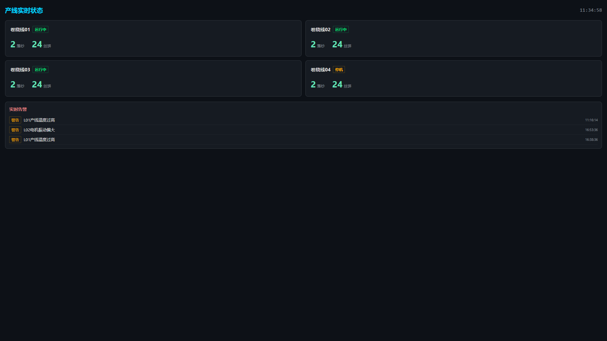

- **产线卡片**：按产线展示运行状态（运行中 / 停机）、落纱次数、丝饼数量
- **实时告警**：底部滚动显示当前告警

---

### 3.3 现场工位

工位界面为触屏与手套操作设计，按钮大、操作路径短。

#### 3.3.1 卷绕工位


| 区域 | 功能 |
|---|---|
| 当前批次 | 显示当前生产的批号、规格、产品类型 |
| 生产计数 | 今日落纱次数、今日丝饼数量、PLC 数据状态 |
| 最近落纱 | 按时间倒序显示各机位的落筒记录：机位、落筒号、锭数、时间 |
| 料车区 | 当前识别到的料车号、装车操作、已装载料车列表及状态 |

**料车号由 PLC 读取 RFID 自动识别**，不允许手工输入，避免手套环境下输入错误。

**断网提示**：网络中断时页面显示「离线 · 待同步 N 条」，数据在本地缓存，恢复后自动上传。

#### 3.3.2 外检工位

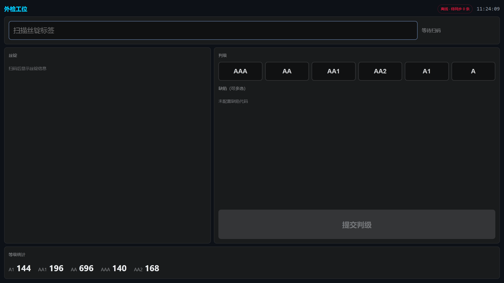

| 区域 | 功能 |
|---|---|
| 扫描区 | 扫码枪扫描丝饼标签，自动带出该丝饼信息 |
| 丝饼信息 | 显示编码、批号、机位、锭位、重量等 |
| 判级区 | 六个等级按钮：AAA / AA / AA1 / AA2 / A1 / A |
| 缺陷选择 | 可多选缺陷代码，与判级结果一并提交 |
| 提交判级 | 一键提交至系统 |
| 等级统计 | 底部实时显示当班各等级已判数量 |

#### 3.3.3 包装工位

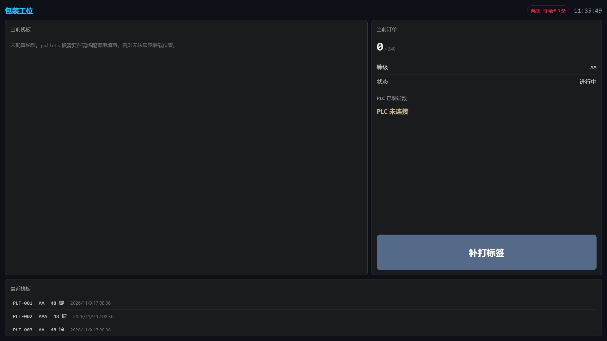

| 区域 | 功能 |
|---|---|
| 当前栈板 | 按栈型显示三维装载位，标出已装与待装位置 |
| 当前订单 | 显示进行中的打包单：等级、目标数量、已装数量、状态 |
| 补打标签 | 标签丢失或打印异常时单独补打 |
| 最近栈板 | 最近完成堆垛的栈板号、等级、锭数、时间 |

#### 3.3.4 仓库工位


| 区域 | 功能 |
|---|---|
| 库位状态 | 仓库库位图，选中库位后可操作 |
| 库位统计 | 空闲、占用、预留库位数与占用率 |
| 手动入库 | 选中库位后执行入库 |
| 手动出库 | 选中库位后执行出库 |
| 待入库料车 | 已装载待入库的料车列表及其状态 |

---

## 4. 数据层级关系

系统按以下四层组织生产数据，每层均可独立查询与外送：

```
批次（批号、规格、工艺参数）
  └─ 落筒（产线 + 机位 + 落筒号 + 落筒时刻）
       └─ 丝饼（锭位 1..N，含等级与重量）
            ├─ 归集到 丝车（一车承载 2~3 个落筒）
            └─ 归集到 栈板（一垛 48 锭，可跨落筒、跨丝车）
```

### 4.1 各层说明

| 层级 | 说明 | 唯一标识 |
|---|---|---|
| 批次 | 产品主数据，含批号、规格、工艺参数、码垛与重量规则 | 批号 |
| 落筒 | 卷绕机一个机位的一次落筒作业 | 产线 + 机位 + 落筒号 + 批号 + 落筒时刻 |
| 丝饼 | 单锭产品，质量追溯的最小单位 | 丝饼编码 |
| 丝车 | 生产现场转运载具，一车承载 2~3 个落筒 | 丝车号 / RFID |
| 栈板 | 成品包装单位，一垛 48 锭 | 栈板编码（可作箱号） |

### 4.2 关系说明

- **丝车与落筒**：一车承载 2~3 个落筒，POY 通常 2 个、FDY 通常 3 个
- **栈板与丝饼**：栈板记录其装载的全部 48 个丝饼明细，含层号与位号
- **丝车与栈板不直接关联**：两者均通过丝饼建立联系。需要由栈板反查丝车或落筒时，可通过栈板内的丝饼编码逐级回溯
- **丝车实时状态**：系统实时计算丝车应载锭数、车上剩余锭数，并据此给出「满车 / 部分取走 / 已取空」状态，随丝饼被取走而变化

### 4.3 丝饼编码规则

```
{批号}-{产线}-W{机位}{侧别}-{年月日时分秒}-{落筒号}-{锭位}

示例：HX_2026_001-L01-W2R-261115110000-002-01
      批号       产线 机位右 落筒时刻      落筒号 锭位
```

编码由业务身份直接推导，同一丝饼无论重传多少次编码不变，可直接印在标签上供扫码识别。编码中包含落筒时刻，可在落筒号循环使用的情况下准确定位每一次落筒。

---

## 5. 相关文档

| 文档 | 内容 |
|---|---|
| 对外数据接口说明 | 各阶段对外提供的数据字段、类型、示例值，以及与客户方 ERP 的字段对应关系 |
